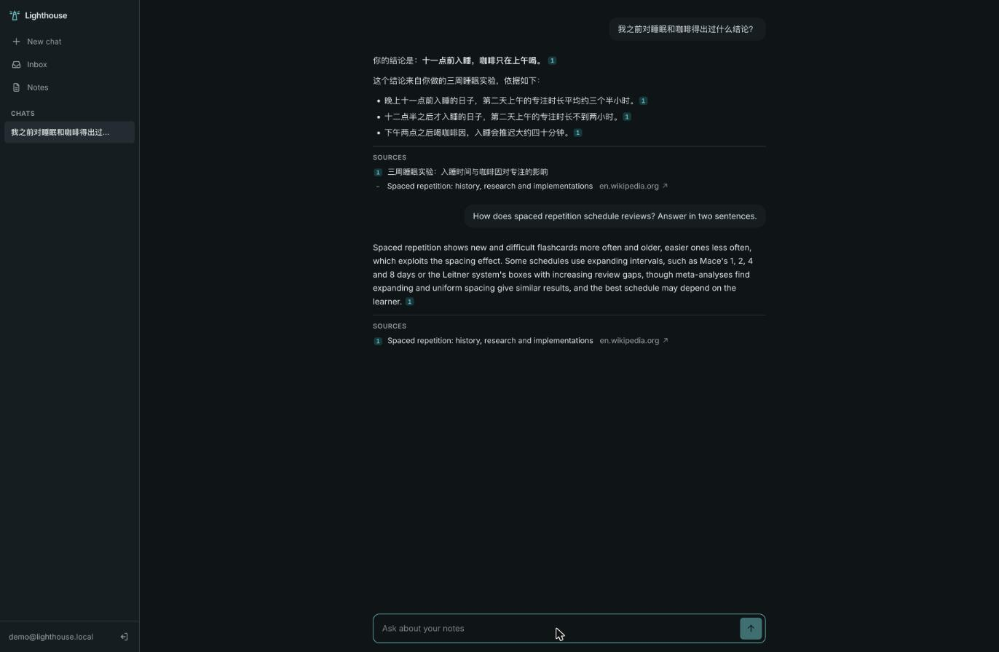
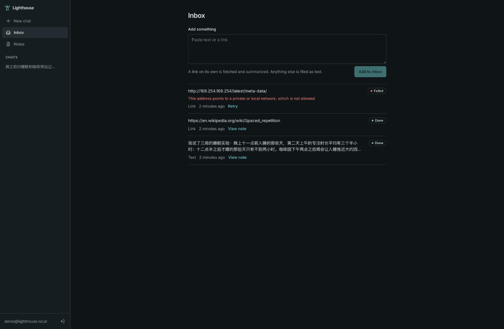
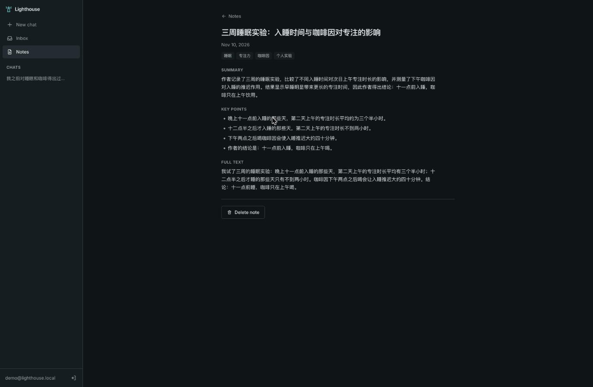
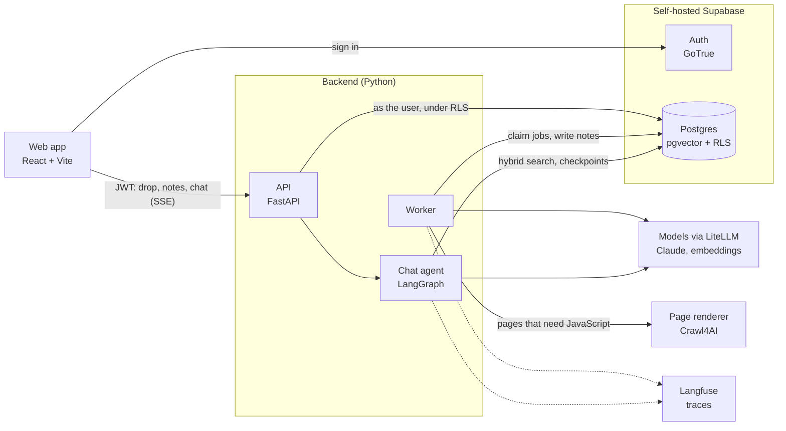

# Lighthouse

A self-hosted notes agent. Paste a link or some text and it is distilled into a structured note;
ask a question later and an agent answers from your notes, citing the ones it used.



| Inbox: what was dropped and what happened to it | A distilled note |
|---|---|
|  |  |

## Why I built it

I save links and scribble notes all day and almost never go back to sort them. I wanted
something on a small server at home that does the filing for me, so that weeks later I can ask
"what did I conclude about X?" and get an answer that points at where it came from. It is also
how I am learning the agent stack: by building something I want to use.

The name is borrowed from the Lighthouse, the base in *Agents of S.H.I.E.L.D.* The agents inside
it will get names from the show too.

## How it works



**Drop flow.** `POST /api/drop` stores the item and returns at once. A worker claims it from
Postgres (`FOR UPDATE SKIP LOCKED`, so the table is the job queue), reads the link if it is one,
asks a model to distill it into a fixed structure (title, summary, key points, tags), splits
the text into chunks, embeds them, and writes the note and its chunks in one transaction.

**Reading a link** ([`source.py`](src/lighthouse/ingest/source.py)). A YouTube link becomes the
video's captions. Anything else gets one plain HTTP request, which is enough for most articles
and for PDFs. If that finds no text, or the site turns it away, the page is opened in a headless
browser ([Crawl4AI](https://github.com/unclecode/crawl4ai), a separate container) and comes back
as Markdown.

**Chat flow.** The agent is a small explicit LangGraph graph: call the model, run the tools it
asked for, loop until it answers. Its tools search the notes and read one note. Conversation
state is checkpointed in Postgres, and the answer is streamed to the browser over server-sent
events with `[note:…]` markers that the web app turns into numbered citations.

**Search.** One SQL function combines pgvector cosine similarity with Postgres full-text search
and merges the two rankings with reciprocal rank fusion
([migration](supabase/migrations/0001_init.sql)).

## Design decisions

- **Row level security does the isolation.** The API verifies the Supabase JWT, then runs each
  request's queries as the `authenticated` role with that user's id in the transaction's claims
  ([`db.py`](src/lighthouse/db.py)). Policies in the database decide what is visible; the route
  handlers contain no `where user_id = …`. A test signs in as two users and checks neither can
  read, change or search the other's data.
- **The agent never reads raw web pages.** Fetched text is untrusted input. It is distilled by a
  separate model call that has no tools, and the chat agent is only shown the distilled fields.
  Source chunks are still embedded and searched, so recall does not suffer, but a page saying
  "ignore your instructions" never reaches a model that can act. The cost is detail: an answer
  cannot quote something the distill step left out.
- **Fetching links is guarded against server-side request forgery.** The fetcher resolves the
  host, refuses private, loopback and link-local addresses, connects to the address it checked,
  and re-checks on every redirect ([`fetch.py`](src/lighthouse/ingest/fetch.py)). The headless
  browser follows redirects on its own, so it runs on a separate Docker network from which the
  database and the other services cannot be reached.
- **Postgres is the only stateful service the app needs.** Notes, vectors, the job queue and chat
  history all live there. No separate vector database, queue or cache to run and keep in sync.
- **Models are configuration.** Every call goes through LiteLLM; the chat, distill and embedding
  models are three environment variables.
- **Every model call is traced.** A chat turn or a distill run is one Langfuse trace showing the
  model calls, tool calls, inputs, outputs and cost.

## Trade-offs

What I considered instead, and what each choice cost:

- **Notes are rows in Postgres, not Markdown files in a git repository.** Markdown in git was
  the first plan: readable anywhere, with history for free. But search, per-user isolation and
  the job queue all wanted a database. This gives up git history and editing notes in any
  editor; a Markdown export may come later.
- **Supabase is self-hosted, not the cloud service.** The project is meant to run on my own
  server. The price is six more containers to run and keep updated.
- **Search is one SQL function, not a retrieval framework.** LlamaIndex was the alternative. For
  short notes, one function that can be read top to bottom was enough; I plan to use LlamaIndex
  for a paper library, where documents are long.
- **The web app is a Vite single-page app, not Next.js.** Nothing here needs server-side
  rendering, and static files behind Caddy are lighter to host on a small server.
- **A plain HTTP request first, a headless browser only when that fails.** The first version had
  no browser, and too many real pages came out empty: they are built with JavaScript. The
  browser costs a 5.7 GB image and about 0.7 GB of memory, so it is the second attempt, not the
  first; most articles never reach it and take about a second.
- **Two models, not one.** Chat decides when and what to search and has to cite correctly, so it
  gets the stronger model; distilling is a fixed-structure task and gets the cheaper one.
- **The embedding size is fixed in the schema.** The column is `vector(1536)`. Changing the
  embedding model later means a migration and re-embedding every note.

## How it was built

It started as an agent loop written by hand against the raw Anthropic SDK, then rewritten in
LangGraph to see what the framework adds ([`playground/`](playground)).

The notes feature was then built in one push with [Claude Code](https://claude.com/claude-code).
I decided what to build, the stack, and the trade-offs above. Four agents implemented it in
parallel, each in its own git worktree: ingest, the chat agent, the web app, and the
infrastructure. Their branches were merged and run end to end against the real stack. A separate
agent then reviewed the result, mainly for leaked secrets and cross-user data access, and the
two issues it found were fixed. Commits carry a `Co-Authored-By: Claude` line.

## Stack

| | |
|---|---|
| Backend | Python 3.12, FastAPI, Pydantic, psycopg 3 |
| Agent | LangGraph, LiteLLM, Claude Sonnet 5.5 (chat), Claude Haiku 5.5 (distill), `text-embedding-3-small` |
| Data | PostgreSQL 17, pgvector (HNSW), full-text search, row level security |
| Platform | Self-hosted Supabase (Postgres, GoTrue auth, PostgREST, Kong, Studio) |
| Frontend | React, TypeScript, Vite, Tailwind CSS, TanStack Query |
| Observability | Self-hosted Langfuse |
| Tooling | Docker Compose, GitHub Actions, uv, ruff, basedpyright, pytest, Vitest, gitleaks |

## Run it

Needs Docker, Python 3, an Anthropic API key and an OpenRouter API key (for embeddings).

```sh
python3 scripts/gen_secrets.py   # creates .env with freshly generated secrets
$EDITOR .env                     # set ANTHROPIC_API_KEY and OPENROUTER_API_KEY
docker compose up -d --build
python3 scripts/create_user.py   # asks for an email and a password
```

Open http://localhost:3000, sign in, drop something into the inbox, then ask about it. There is
no sign-up form: this is a tool for its owner, so accounts are created on the server. Traces are at http://localhost:3100 and the database UI at http://localhost:3001; logins and
everything else are in [docs/DEPLOY.md](docs/DEPLOY.md). The whole stack uses 3 to 4 GB of
memory. Langfuse is about half of that and the page renderer about 0.7 GB; both can be left out.

To see the web app alone with fake data: `cd web && pnpm install && pnpm dev:mock`.

## Develop

```sh
# Backend: tests need a Postgres with pgvector
docker run -d --name lighthouse-test-db -e POSTGRES_PASSWORD=postgres -p 54330:5432 pgvector/pgvector:pg17
uv sync
uv run pytest                    # no API keys needed: models and network are faked
uv run ruff check && uv run basedpyright

# Web
cd web && pnpm install && pnpm lint && pnpm typecheck && pnpm test
```

| Path | What |
|---|---|
| [`src/lighthouse/api/`](src/lighthouse/api) | HTTP routes: drop and inbox, notes, threads, chat stream |
| [`src/lighthouse/ingest/`](src/lighthouse/ingest) | Read a link (fetch, PDF, YouTube captions, renderer), distill, chunk, and the pipeline that ties them together |
| [`src/lighthouse/worker.py`](src/lighthouse/worker.py) | Background worker |
| [`src/lighthouse/agent/`](src/lighthouse/agent) | The LangGraph graph, its tools and prompt |
| [`src/lighthouse/retrieval.py`](src/lighthouse/retrieval.py) | Hybrid search, collapsed from chunks to notes |
| [`supabase/migrations/`](supabase/migrations) | Schema, RLS policies, search function |
| [`web/`](web) | The single-page app |
| [`docker-compose.yml`](docker-compose.yml), [`docker/`](docker), [`infra/`](infra) | The stack |
| [`docs/API.md`](docs/API.md) | API reference, including the chat event stream |
| [`playground/`](playground) | The same agent loop written twice by hand: raw Anthropic SDK, then LangGraph |

## Limits and what is next

- Pages behind a login or a paywall, sites that check for robots, scanned PDFs and videos
  without captions cannot be read; the inbox says why and the text can be pasted instead.
- The keyword half of search uses Postgres' `simple` text configuration, which does not segment
  Chinese; Chinese queries rely on the vector half.
- On Claude Sonnet 5.5, an answer that follows a tool call can arrive in one piece rather than
  token by token.
- Next: calendar and reminders through MCP tools with a confirmation step, a phone share entry,
  merging related notes.
