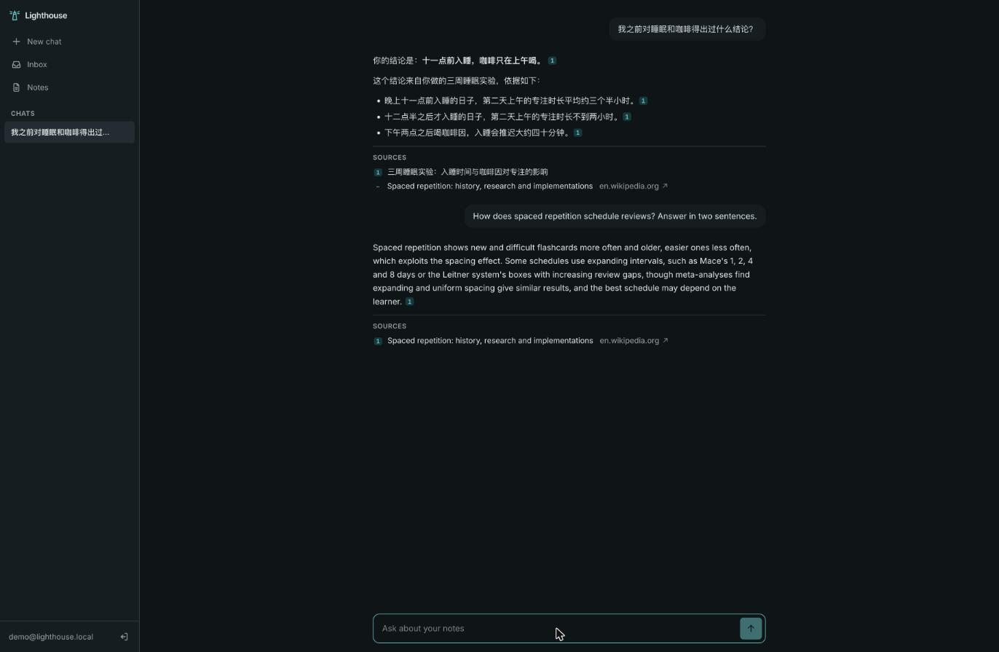
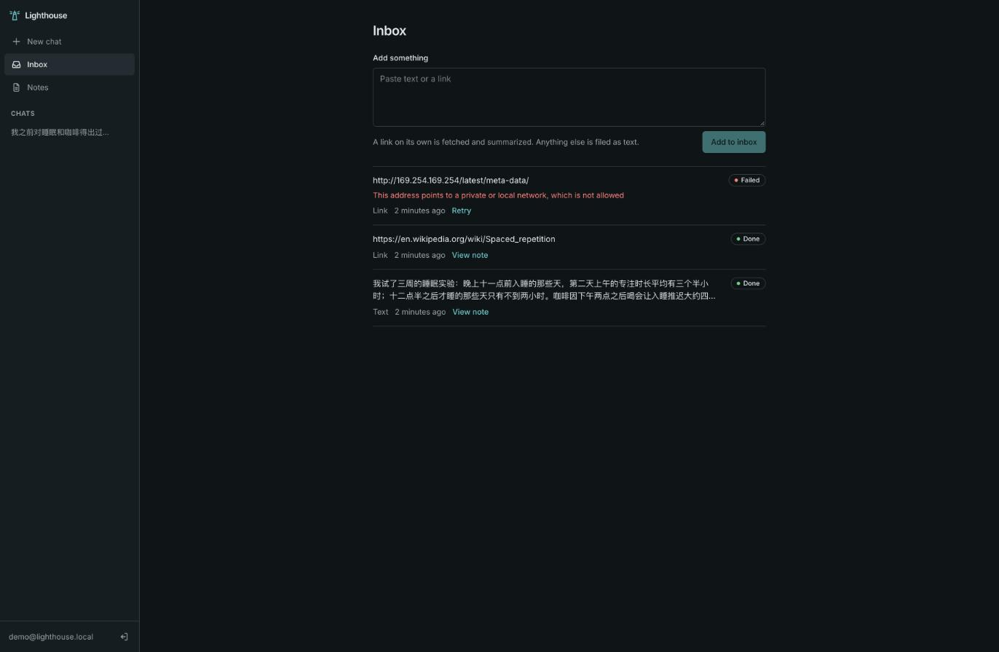
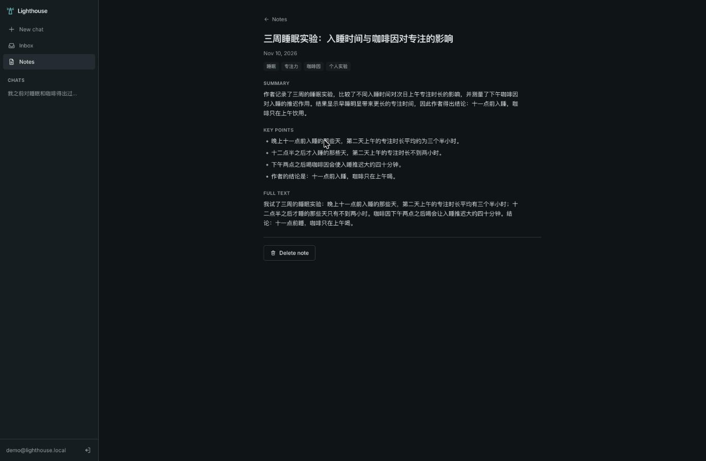
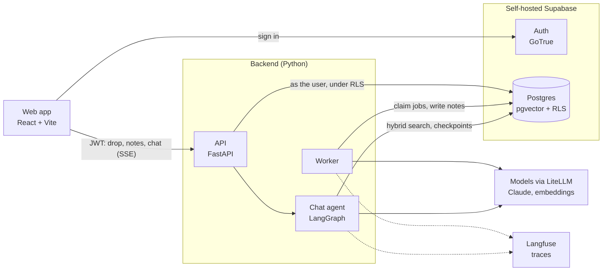

# Lighthouse

A self-hosted notes agent. Paste a link or some text and it is distilled into a structured note;
ask a question later and an agent answers from your notes, citing the ones it used.



| Inbox: what was dropped and what happened to it | A distilled note |
|---|---|
|  |  |

## How it works



**Drop flow.** `POST /api/drop` stores the item and returns at once. A worker claims it from
Postgres (`FOR UPDATE SKIP LOCKED`, so the table is the job queue), fetches the page if it is a
link, asks a model to distill it into a fixed structure (title, summary, key points, tags), splits
the text into chunks, embeds them, and writes the note and its chunks in one transaction.

**Chat flow.** The agent is a small explicit LangGraph graph: call the model, run the tools it
asked for, loop until it answers. Its tools search the notes and read one note. Conversation
state is checkpointed in Postgres, and the answer is streamed to the browser over server-sent
events with `[note:…]` markers that the web app turns into numbered citations.

**Search.** One SQL function combines pgvector cosine similarity with Postgres full-text search
and merges the two rankings with reciprocal rank fusion
([migration](supabase/migrations/0001_init.sql)).

## Design decisions

- **Row level security does the isolation.** The API verifies the Supabase JWT, then runs each
  request's queries as the `authenticated` role with that user's id in the transaction's claims
  ([`db.py`](src/lighthouse/db.py)). Policies in the database decide what is visible; the route
  handlers contain no `where user_id = …`. A test signs in as two users and checks neither can
  read, change or search the other's data.
- **The agent never reads raw web pages.** Fetched text is untrusted input. It is distilled by a
  separate model call that has no tools, and the chat agent is only shown the distilled fields.
  Source chunks are still embedded and searched, so recall does not suffer, but a page saying
  "ignore your instructions" never reaches a model that can act.
- **Fetching links is guarded against server-side request forgery.** The fetcher resolves the
  host, refuses private, loopback and link-local addresses, connects to the address it checked,
  and re-checks on every redirect ([`fetch.py`](src/lighthouse/ingest/fetch.py)).
- **Postgres is the only stateful service the app needs.** Notes, vectors, the job queue and chat
  history all live there. No separate vector database, queue or cache to run and keep in sync.
- **Models are configuration.** Every call goes through LiteLLM; the chat, distill and embedding
  models are three environment variables.
- **Every model call is traced.** A chat turn or a distill run is one Langfuse trace showing the
  model calls, tool calls, inputs, outputs and cost.

## Stack

| | |
|---|---|
| Backend | Python 3.12, FastAPI, Pydantic, psycopg 3 |
| Agent | LangGraph, LiteLLM, Claude Sonnet 5.5 (chat), Claude Haiku 5.5 (distill), `text-embedding-3-small` |
| Data | PostgreSQL 17, pgvector (HNSW), full-text search, row level security |
| Platform | Self-hosted Supabase (Postgres, GoTrue auth, PostgREST, Kong, Studio) |
| Frontend | React, TypeScript, Vite, Tailwind CSS, TanStack Query |
| Observability | Self-hosted Langfuse |
| Tooling | Docker Compose, GitHub Actions, uv, ruff, basedpyright, pytest, Vitest, gitleaks |

## Run it

Needs Docker, Python 3, an Anthropic API key and an OpenRouter API key (for embeddings).

```sh
python3 scripts/gen_secrets.py   # creates .env with freshly generated secrets
$EDITOR .env                     # set ANTHROPIC_API_KEY and OPENROUTER_API_KEY
docker compose up -d --build
```

Open http://localhost:3000, create an account, drop something into the inbox, then ask about
it. Traces are at http://localhost:3100 and the database UI at http://localhost:3001; logins and
everything else are in [docs/DEPLOY.md](docs/DEPLOY.md). The whole stack idles at under 3 GB of
memory, of which Langfuse is about half and can be left out.

To see the web app alone with fake data: `cd web && pnpm install && pnpm dev:mock`.

## Develop

```sh
# Backend: tests need a Postgres with pgvector
docker run -d --name lighthouse-test-db -e POSTGRES_PASSWORD=postgres -p 54330:5432 pgvector/pgvector:pg17
uv sync
uv run pytest                    # no API keys needed: models and network are faked
uv run ruff check && uv run basedpyright

# Web
cd web && pnpm install && pnpm lint && pnpm typecheck && pnpm test
```

| Path | What |
|---|---|
| [`src/lighthouse/api/`](src/lighthouse/api) | HTTP routes: drop and inbox, notes, threads, chat stream |
| [`src/lighthouse/ingest/`](src/lighthouse/ingest) | Fetch, distill, chunk, and the pipeline that ties them together |
| [`src/lighthouse/worker.py`](src/lighthouse/worker.py) | Background worker |
| [`src/lighthouse/agent/`](src/lighthouse/agent) | The LangGraph graph, its tools and prompt |
| [`src/lighthouse/retrieval.py`](src/lighthouse/retrieval.py) | Hybrid search, collapsed from chunks to notes |
| [`supabase/migrations/`](supabase/migrations) | Schema, RLS policies, search function |
| [`web/`](web) | The single-page app |
| [`docker-compose.yml`](docker-compose.yml), [`docker/`](docker), [`infra/`](infra) | The stack |
| [`docs/API.md`](docs/API.md) | API reference, including the chat event stream |
| [`playground/`](playground) | The same agent loop written twice by hand: raw Anthropic SDK, then LangGraph |

## Limits and what is next

- Pages that need JavaScript or a login cannot be fetched; the inbox says so and the text can be
  pasted instead.
- The keyword half of search uses Postgres' `simple` text configuration, which does not segment
  Chinese; Chinese queries rely on the vector half.
- On Claude Sonnet 5.5, an answer that follows a tool call can arrive in one piece rather than
  token by token.
- Next: calendar and reminders through MCP tools with a confirmation step, a phone share entry,
  merging related notes.
